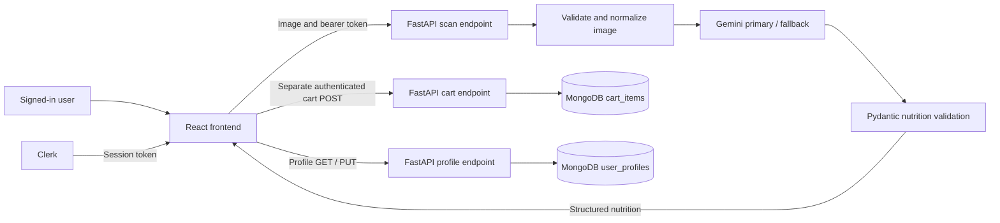

# NutriGo AI — Project Overview and Sprint Delivery Plan

Prepared: October 28, 2026. Assessment basis: current local source code and the supplied Sprint 3 and Sprint 4 screenshots. This is a documentation review; tests, live services, hosting settings, and remote CI runs were not executed or verified. Team contributions below follow the team's supplied attribution.

## 1. Project overview

NutriGo AI is a smart, full-stack grocery and nutrition assistant designed to help users manage food purchases, monitor dietary intake, and stay within the set calorie limit. Powered by Google's Gemini 2.5 Flash vision model via the `google-genai` SDK, the platform allows users to upload or capture photos of physical nutrition labels to automatically extract product names, calorie counts, and macronutrients—including protein, carbohydrates, and fats—into structured data. This extracted information instantly populates a dynamic shopping cart stored in MongoDB Atlas (`nutrigo_db.cart_items`), enabling real-time calculations of overall nutritional totals, and macro distributions.

The application features a modern cream-and-sage interface built with React (Vite), React Router, Tailwind CSS, and Lucide React icons, deployed seamlessly on Vercel. On the backend, a high-performance FastAPI service running on Render handles data validation via Pydantic schemas, manages custom CORS policies, and integrates Sentry for continuous error tracking. Secure cross-platform user authentication is powered by Clerk, maintaining personalized cart states across sessions. The entire architecture is supported by automated `pytest` test suites and continuous integration and deployment (CI/CD) pipelines managed through GitHub Actions to ensure reliable performance.

> **Scope clarification:** The overview above preserves the team's supplied product description. The current code implements image uploads, per-item nutrient display, quantity-weighted calorie totals, and a personal cart calorie alert. It does not yet implement an explicit camera interface, aggregate macro distributions, grocery expense totals, a budget setting, or a food-consumption diary. Price exists in the backend schema but is not entered or displayed in the active dashboard. Hosting and performance claims require deployment evidence. These distinctions are reflected in the plan below.

## 2. Team roles and responsibilities

### Kylin Eudora Cabrera — DevOps, Backend, AI Engineer, and Database Administrator

As the **DevOps, Backend, AI Engineer, and Database Administrator**, **Kylin Eudora Cabrera** designed and implemented the application's core infrastructure, data storage, and intelligent processing pipelines. She engineered the FastAPI backend hosted on Render, configuring custom CORS policies, authentication controls, and Sentry error monitoring. She built and managed the MongoDB Atlas database (`nutrigo_db.cart_items`), designing persistent data schemas for user shopping carts. Additionally, she integrated Google's Gemini 2.5 Flash vision model using the `google-genai` SDK to extract nutrition labels into validated JSON data. To support team workflows and production deployments, she set up GitHub Actions CI/CD and automated `pytest` backend tests.

For the remaining work, Kylin owns AI evaluation tooling, backend tests, API validation, database reliability, security controls, CI measurements, deployment, and rollback evidence.

### Clent Supapo — Frontend Developer

As the **Frontend Developer**, **Clent Supapo** focused on building and styling the client-side user experience and web layout. He developed responsive interface components using React (Vite), React Router, Tailwind CSS, and Lucide React icons, adhering to the project's signature cream-and-sage aesthetic. His responsibilities cover product landing pages, Clerk authentication interfaces, image-upload interactions, and grocery dashboards that present nutrition information.

For the remaining work, Clent owns real-label sample collection, browser acceptance checks, upload and recovery UX, accessibility and responsive polish, frontend CI checks, user documentation, and any agreed macro/budget interface. Camera dialogs and aggregate macro progress described in the team's intended scope still need implementation or explicit deferral.

## 3. Technology stack and architecture

NutriGo AI connects vision processing, cloud document storage, and a responsive frontend through an authenticated REST API.

| Layer | Technology | Role and current evidence |
| --- | --- | --- |
| Frontend | React, Vite | Components, state management, development server, and production bundling. |
| Navigation | React Router | Landing, Clerk sign-in/sign-up, dashboard, and profile; old login/signup URLs redirect to Clerk pages. |
| Styling | Tailwind CSS, custom CSS, Lucide React | Cream-and-sage theme, responsive layouts, icons, and authentication styling. |
| Authentication | Clerk | Browser sessions and bearer tokens; backend verifies RS256 signature, issuer, expiration, subject, and allowed frontend origin. |
| Backend | Python 3, FastAPI, Uvicorn | REST endpoints for scanning, cart CRUD, profiles, and health checks; CI uses Python 3.11. |
| Validation | Pydantic | Validates nutrition responses, cart fields, and profile measurements. |
| Image processing | Pillow | Validates actual image bytes, corrects EXIF orientation, handles transparency, and normalizes images to bounded JPEGs. |
| AI | Google GenAI SDK, Gemini 2.5 Flash | Extracts per-serving nutrition into structured JSON; default fallback is Gemini 2.5 Flash Lite. |
| Storage | MongoDB Atlas, Motor/PyMongo | Intended cloud storage; database is configurable, defaulting to `nutrigo_db`; active collections include `cart_items` and `user_profiles`. |
| Monitoring | Sentry | Optional backend error/performance instrumentation enabled by `SENTRY_DSN`; delivery needs verification. |
| Cross-origin requests | FastAPI CORS middleware | Configurable frontend origins; production needs an explicit origin list. |
| Hosting | Render, Vercel | Render backend URL and deploy hook appear in code; Vercel SPA rewrites are configured. Actual deployment status is unverified. |
| Quality and workflow | Git, GitHub, pytest, GitHub Actions, ESLint | Backend tests run in the workflow; frontend build/lint scripts exist but are not yet in that workflow. |

The existing GitHub Actions workflow triggers Render after successful backend checks on pushes to `main`. Vercel automatic previews and production deployment would depend on the hosting project's Git integration; they are not implemented as steps in this workflow.

### Current request flow



Scanning and saving are two requests. A successful scan alone does not prove that an item was saved. The dashboard updates after the cart API confirms success. Nutrition is extracted per labeled serving, and the dashboard multiplies calories by quantity; package serving counts are not modeled.

## 4. Annotated project directory

Paths below are relative to the `Endterm_Ai` repository root. Installed packages, Git internals, Python bytecode, and test caches are omitted. Generated build assets are summarized because their hashed names change. Environment-file values are intentionally not included.

```text
Endterm_Ai/
|-- PROJECT_REPORT.md                 # This overview, evidence review, and delivery plan.
|-- README.md                         # Backend setup and image-scanning/fallback documentation.
|-- requirements.txt                  # Python backend, AI, database, image, and test dependencies.
|-- pytest.ini                        # Test discovery and Python import-path settings.
|-- .env                              # Local backend environment configuration; keep private.
|-- .env.example                      # Example backend environment variables without real credentials.
|-- .gitignore                        # Excludes secrets, environments, build output, and caches.
|-- package.json                      # Root-level Lucide dependency declaration.
|-- package-lock.json                 # Locked root-level npm dependency resolution.
|-- .github/
|   `-- workflows/
|       `-- ci.yml                    # Backend import/tests and Render deployment hook on main.
|-- app/
|   |-- __init__.py                   # Marks the backend as a Python package.
|   |-- main.py                       # FastAPI app, CORS, Sentry, routers, health, and DB error handling.
|   |-- database.py                   # MongoDB client and shared database accessor.
|   |-- models.py                     # Cart schemas and retained legacy authentication/profile schemas.
|   |-- clerk_auth.py                 # Clerk token verification and current-user identification.
|   |-- auth.py                       # Legacy bcrypt password hashing and custom JWT generation.
|   `-- routes/
|       |-- __init__.py               # Marks the routes directory as a Python package.
|       |-- ai_routes.py              # Image validation, Gemini fallback, structured nutrition extraction.
|       |-- cart_routes.py            # Authenticated, user-scoped grocery CRUD operations.
|       |-- profile_routes.py         # Reads/upserts height, weight, and shopping calorie limit.
|       `-- auth_routes.py            # Legacy registration/login router; not mounted by the active app.
|-- tests/
|   |-- test_ai.py                    # Mocked Gemini, fallback, validation, image, and timeout tests.
|   |-- test_cart.py                  # Cart authentication, ID validation, ownership, and creation tests.
|   |-- test_main.py                  # Root and AI-module status endpoint tests.
|   `-- test_profile.py               # Profile validation, account isolation, and persistence-call tests.
`-- frontend/
    |-- .env                          # Local frontend configuration; values omitted from this report.
    |-- .env.example                  # API URL and Clerk publishable-key examples.
    |-- .gitignore                    # Excludes frontend dependencies, builds, and local configuration.
    |-- README.md                     # Mostly the React/Vite template documentation.
    |-- package.json                  # Frontend dependencies and dev/build/lint/preview scripts.
    |-- package-lock.json             # Locked frontend npm dependency resolution.
    |-- vite.config.js                # Vite React and Tailwind plugins.
    |-- eslint.config.js              # JavaScript, React Hooks, and refresh lint rules.
    |-- vercel.json                   # SPA rewrite for client-side routes on Vercel.
    |-- index.html                    # HTML entry, favicon, title, and font loading.
    |-- clerk-react/
    |   `-- tsconfig.node.json        # Empty configuration artifact; review whether it is needed.
    |-- public/
    |   |-- favicon.svg               # Browser favicon asset.
    |   `-- icons.svg                 # Static SVG icon asset.
    |-- dist/                         # Generated frontend build; do not edit as source.
    |   |-- index.html                # Generated production HTML entry.
    |   |-- favicon.svg               # Copied public favicon.
    |   |-- icons.svg                 # Copied public icon asset.
    |   `-- assets/                   # Generated, hashed JavaScript and CSS bundles.
    `-- src/
        |-- main.jsx                  # Mounts React and configures ClerkProvider.
        |-- App.jsx                   # Public routes, Clerk pages, and protected dashboard/profile.
        |-- index.css                 # Tailwind theme, colors, typography, and body styles.
        |-- assets/
        |   |-- hero.png              # Bundled image asset.
        |   |-- react.svg             # Retained React graphic asset.
        |   `-- vite.svg              # Retained Vite graphic asset.
        |-- components/
        |   |-- AppHeader.jsx         # Shared navigation, user greeting, sign-out, and service indicator.
        |   |-- Brand.jsx             # Standalone brand component retained outside active page imports.
        |   |-- ProtectedRoute.jsx    # Legacy localStorage-token guard; active routes use Clerk.
        |   `-- ScanLabelModal.jsx    # Alternate upload component; active dashboard has its own scan UI.
        |-- lib/
        |   |-- api.js                # Shared fetch/error handling and authenticated API helpers.
        |   `-- imageUpload.js        # Shared browser-side image type/size validation.
        `-- pages/
            |-- Landing.jsx          # Public product introduction and sign-in/sign-up links.
            |-- AuthPage.jsx         # Active styled Clerk SignIn and SignUp components.
            |-- AuthPage.css         # Responsive styling for Clerk authentication pages.
            |-- Dashboard.jsx        # Upload, scan/save, cart quantities/removal, and calorie alert.
            |-- Profile.jsx          # Profile form, persisted trip limit, and informational BMI.
            |-- Login.jsx            # Retained custom login page; not used by active routing.
            `-- Signup.jsx           # Retained custom signup page; not used by active routing.
```

## 5. Current progress against Sprint 3

**Verdict: Sprint 3 is substantially implemented but not ready to mark fully complete.** Mocked AI tests are now present. The main missing deliverable is a documented evaluation set of real nutrition-label examples with expected results, plus recorded end-to-end and CI evidence.

Status meanings: **Implemented** means present in source, not independently proven in production; **Partial** means some work or evidence remains; **Missing** means no corresponding deliverable was found in the inspected project.

| Screenshot requirement | Status | Current evidence | What is needed to close it |
| --- | --- | --- | --- |
| AI feature integrated through backend using structured output, tool calling, retrieval, or multi-step logic | Implemented | [AI route](app/routes/ai_routes.py) uses image input, JSON response schema, and primary/fallback models. Structured output satisfies this requirement; RAG/tool calling is not additionally necessary. | Record a successful representative scan on the release candidate. |
| Backend validation, transformation, or storage of AI output | Implemented | Pillow validates/transforms images; Pydantic validates nutrition; [dashboard](frontend/src/pages/Dashboard.jsx) sends output to authenticated [cart storage](app/routes/cart_routes.py). | Verify scan, save, refresh, quantity change, and deletion under the same account. |
| Small evaluation set of example inputs with expected outputs or acceptance checks | Missing | AI tests use generated blank images and mocked nutrition output; these test software behavior, not actual label-reading accuracy. | Add real-label fixtures, manually verified expected values, acceptance rules, and recorded evaluation results. |
| Mocked LLM calls in automated tests so CI avoids a paid live API | Implemented; execution evidence pending | [test_ai.py](tests/test_ai.py) mocks the GenAI client; [CI](.github/workflows/ci.yml) runs pytest and discovers these tests. | Attach a passing CI run; ensure test execution requires no live Gemini credentials or calls. |
| First-pass handling of timeouts, provider errors, and malformed output | Implemented | Bounded attempts, total provider timeout, fallback, safe provider logging, and schema validation; tests cover several success/error branches. | Record UI behavior for exhausted fallback, unreadable labels, and scan success followed by storage failure. |

### Proposed Sprint 3 evaluation deliverable

Create a small, reproducible set of approximately 10 owned or permitted images: clear labels in JPEG/PNG/WebP, rotated and reflective labels, a multi-serving package, small text, an unreadable label, and a non-label image. Avoid personal information in photos.

For each case record an ID, image path, expected product name or acceptable aliases, per-serving calories/protein/carbs/fat, expected acceptance/rejection, model configuration, actual output, latency, and pass/fail. Verify expected numbers manually against the label. Define tolerances before running the evaluation; do not invent missing nutrient values. Ambiguous product names may require a documented review/rejection rule.

Suggested acceptance: all clear-label cases match the recorded numeric values within explicitly documented rounding tolerance; unreadable or non-label cases are rejected; no invalid result is saved. Report every case and any remaining failure. Keep live evaluations manual or explicitly opt-in; ordinary CI must use mocked provider responses.

## 6. Current progress against Sprint 4

**Verdict: Sprint 4 remains in progress.** Several foundations exist, but release readiness needs evidence and additional work.

| Screenshot requirement/check | Status | Existing foundation | Remaining deliverable |
| --- | --- | --- | --- |
| Complete error handling for AI failures and malformed requests | Partial | Upload byte/type/size/pixel validation, fallback, bounded provider timeouts, Pydantic validation, and MongoDB error response. | Exercise missing uploads, malformed multipart/JSON, expired sessions, database outages, and scan/save partial failures; verify no false success or duplicate items during recovery. |
| Loading, empty states, and readable errors | Partial | Scan spinner, cart skeleton/empty state, retry, profile errors, disabled controls. | Browser/mobile/keyboard checks; upload focus/accessibility, clear scan-versus-save feedback, and consistent recovery. |
| Security review: no secrets in history, input limits, rate or cost guards | Partial | Clerk verification, user-scoped database filters, 10 MB/25 MP image bounds, bounded fallback. | Audit Git history without publishing secrets; rotate any exposed keys; add per-user AI rate/cost controls, review numeric limits, explicitly configure CORS, and test account isolation. Bounded retries alone are not a user quota. |
| Pipeline optimization with before-and-after numbers | Missing evidence | Backend CI exists. | Measure baseline and optimized runs under comparable conditions; add dependency caching and frontend checks where appropriate; record timings and tradeoffs. |
| README, architecture diagram, API reference, setup guide | Partial | Backend README documents setup and image fallback; this report adds architecture context. | Complete frontend/backend setup, required env variables, route reference, deployment, troubleshooting, and operating/rollback instructions. |
| Production on a free host and release candidate on a public URL | Configuration present; unverified | Render URL/deploy hook and Vercel rewrite configuration. | Record working frontend/API URLs, provider plan settings, commit IDs, authenticated smoke tests, and DB health. Do not infer free-plan use from configuration. |
| Tagged release and changelog | Missing locally | API version string is `1.0.0`; no local Git tags were listed. | Write release notes and tag the approved release commit, such as `v1.0.0`; verify remote release state. |
| Rollback tested | Missing evidence | No rollback record found. | Revert frontend/backend deployments to known-good versions in a controlled rehearsal and document recovery checks. Account for schema compatibility. |

### Product-scope differences to resolve

| Supplied description | Current behavior | Release decision/work |
| --- | --- | --- |
| Camera capture | File picker and drag-and-drop; no explicit camera flow. | Implement/test camera capture with permission-denied fallback if promised, or describe uploads accurately. |
| Overall macros and macro distributions | Per-item macros shown; only calories are summed. | Add quantity-weighted macro totals if retained in scope; define whether distribution means grams or energy share. |
| Estimated expenses and staying within budget | Backend price field defaults to zero; no active price entry, expense summary, or monetary budget. | Add validated price entry, currency, expense totals, persisted budget and alert, or explicitly defer these claims. |
| Dietary intake monitoring | Tracks groceries in a persistent cart, not food consumed by date. | Describe it as shopping nutrition estimates unless a separate intake log is approved. |
| Package nutrition | Extracts one labeled serving; quantity multiplies that value. | Clarify quantity units; model servings per package before claiming whole-package totals. |

These product extensions are not separately mandated by the screenshots. Prioritize the rubric and accurate release documentation; do not silently expand scope beyond what the team can finish.

## 7. Ordered steps to completion

1. **Agree on release scope.** Kylin and Clent decide which overview claims belong in this release. Record deferrals for camera, budgets, and macro totals if necessary.
2. **Close the evaluation gap.** Clent collects representative label photos and expected results; Kylin adds the evaluation manifest/runner and records model results. Review failures together.
3. **Capture Sprint 3 proof.** Obtain a passing mocked-test CI run and demonstrate sign-in, scan, save, refresh, edit quantity, delete, and account isolation. Use a disposable test account and permitted images.
4. **Finish failure recovery and security.** Add meaningful tests for remaining failure paths, AI rate/cost limits, production origin settings, and authorization. Remove or explicitly retire confusing legacy flows, including the standalone registration endpoint that currently reports success without creating an account.
5. **Polish the UI.** Verify keyboard use, labels, mobile layouts, readable errors, retry actions, and accurate saved-state feedback. Make scan/save failures distinguishable so retries do not unnecessarily incur another AI call.
6. **Measure and improve CI.** Run backend tests and frontend lint/build in CI; record baseline versus improved installation/check duration. Use comparable runs and report medians rather than an invented improvement percentage.
7. **Complete operating documentation.** Document `CLERK_ISSUER_URL`, `FRONTEND_URL`, database settings, Gemini/fallback settings, Sentry, frontend API URL and Clerk key, startup commands, API payloads, and troubleshooting. Never place secret values in docs.
8. **Verify the release candidate and rollback.** Confirm public URLs, configured monitoring, DB connectivity, user isolation, and a known-good deployment recovery procedure.
9. **Publish the approved release.** After checks pass, prepare changelog and tagged release with the commit, public URLs, limitations, evaluation results, pipeline measurements, and rollback record.

## 8. Daily team deliverables

This is a proposed sequence, not a record of completed work. Use Day 1 as the next agreed working day; no calendar deadline was supplied. Sprint 3 closeout is allocated two days, followed by five Sprint 4 days. If an exit condition fails, finish it before moving to release.

### Sprint 3 closeout

| Day | Kylin — Backend / AI / Database / DevOps | Clent — Frontend | Shared daily deliverable and acceptance |
| --- | --- | --- | --- |
| 1: Evaluation set and scope | Define evaluation schema, expected JSON, numeric tolerance, and opt-in live-run procedure. Review existing mocked tests instead of duplicating them. | Collect about 10 label/non-label photos; transcribe expected values; check upload UX and record unsupported-format behavior. | Versioned evaluation cases with expected results; agreed release-scope list; every sample has a clear pass/reject rule and a reviewer. |
| 2: End-to-end evidence | Run evaluation and backend tests; fix demonstrated AI/storage defects; capture passing CI with mocked provider calls and test DB/account isolation. | Demonstrate sign-in → scan → cart → refresh → quantity → delete; record loading/errors and compare displayed values with sample expectations. | Evaluation results, CI link, demo recording/screenshots, and remaining-defect list. Sprint 3 closes only when core flow passes and evaluation outcomes are documented. |

### Sprint 4 — hardening, polish, and release

| Day | Kylin — Backend / AI / Database / DevOps | Clent — Frontend | Shared daily deliverable and acceptance |
| --- | --- | --- | --- |
| 1: Failure handling and security | Add/test AI rate or cost limits and remaining malformed-request/auth/storage cases; audit secrets/history; review CORS and account filters. | Test expired-session, unreadable-label, quota, timeout, and save-failure flows; improve messages and safe retries. | Error/security checklist with evidence: invalid/unauthorized requests rejected, repeated AI use bounded, and failures never shown as saved items. |
| 2: UI polish and scope alignment | Support only agreed data changes; clarify serving/quantity semantics; validate price/budget fields if included and document API contracts. | Finish mobile, keyboard, focus, form labels, loading/empty states; implement agreed macro/budget/camera work or update product copy to match deferrals. | Reviewed UI screenshots, keyboard/mobile checklist, and a scope agreement matching actual functionality. If optional features exceed capacity, defer them explicitly. |
| 3: CI reliability and measurement | Capture baseline runs; add caching and frontend CI checks; make deploy-hook failure detectable and add a post-deploy health check. | Resolve frontend lint/build failures; add meaningful UI checks for critical interactions; record build output and verify production routing. | Passing backend and frontend checks plus before/after table covering install time, test/build time, total CI duration, environment, and sample count. No fabricated gains. |
| 4: Documentation and release candidate | Finish API/env/setup/architecture/operations documentation; deploy candidate and record backend health, Sentry delivery, and current commit. | Finish frontend setup/user guide and screenshots; verify public frontend routes and integrated Clerk → API flow. | Public candidate URLs, complete setup/API docs, evaluation report, smoke-test record, and resolved release-blocking defects. |
| 5: Rollback and release | Rehearse rollback to known-good deployments, verify database compatibility/recovery, then restore candidate; prepare tag and changelog after sign-off. | Re-test the rolled-back and restored frontend, authentication, scans, quantities, profiles, and mobile layouts; prepare final demo. | Dated rollback evidence, final acceptance checklist, approved release tag/changelog, public URLs, and team demo package. |

### Daily handoff format

Each member posts: **completed work**, **PR/commit or evidence link**, **checks performed and actual results**, **blockers**, and **next task**. A task is complete only when its stated acceptance condition is met and the other member can review the evidence. A proposed filename or task in this report does not mean that artifact already exists.

## 9. Final consultation checklist

### Sprint 3

- [ ] Demonstrate the AI feature working end to end.
- [ ] Show backend validation/transformation and persisted cart output.
- [ ] Provide a real-label evaluation set and recorded results.
- [ ] Provide a passing CI run with mocked LLM tests and no paid live API dependency.

### Sprint 4

- [ ] Public release candidate works with authentication, scanning, persistence, and profile updates.
- [ ] Error-handling and UI recovery checks pass.
- [ ] Secret-history review, input limits, account isolation, and rate/cost controls are documented.
- [ ] README, architecture, API reference, and setup/operations guides are complete.
- [ ] Pipeline improvements include measured before-and-after results.
- [ ] Rollback has been rehearsed and recorded.
- [ ] Approved release is tagged and has a changelog.
- [ ] Product claims match implemented features and documented limitations.

These boxes intentionally remain unchecked because this report assesses source evidence rather than certifying test execution or release completion.
