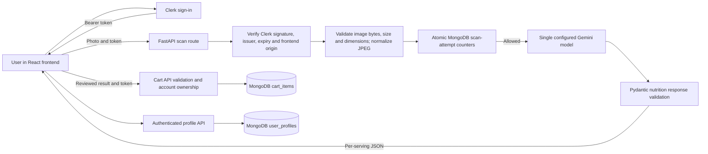

# Current architecture

The scan route uses one model, not fallback models. HTTP timeout is 40 seconds; the provider operation has a 45-second total deadline. Image normalization occurs in a worker thread. The browser enforces a separate 65-second request deadline and displays errors without automatically retrying writes.

Scanning does not save an item. The user reviews the result and can edit its name before a separate cart POST. The UI adds the item only after the cart API confirms success. A timed-out POST can still have committed, so users must refresh before retrying.

Calories are kcal, macros are grams, sodium is milligrams, all per labeled serving. Missing sodium is null. Quantity is the number of labeled servings. The dashboard sums quantity-weighted calories and compares with the stored shopping limit. It is not a consumption diary or grocery budget tracker.

MongoDB's `ai_usage` collection enforces per-user minute/day and global day request limits atomically using the unique `_id` index. Startup creates an expiration index for cleanup. Counters survive restarts and are shared by workers using the same database. Database unavailability denies scans. Earlier reservations are not refunded when a later bucket or the provider fails.

Auth uses Clerk; cart and profile queries scope data to the verified subject. CORS accepts configured explicit origins. Legacy password-auth modules are not mounted; the old fake-success registration endpoint has been removed. Pillow bounds actual decoded image dimensions and strips metadata through JPEG re-encoding. AI schemas reject negative and nonfinite values; profile fields have bounded ranges.

GitHub Actions runs backend tests, frontend tests/lint/build, and a redacted history secret scan in separate jobs. Dependencies are cached by dependency-file hashes. Each install/check records durations in JSON artifacts and the job summary. Deployment is gated on all three jobs; the deploy hook must succeed and `/health` must report both connected MongoDB and the expected commit.

Render backend and Vercel frontend are the configured hosting targets. Actual deployment health, free-tier eligibility, provider settings, model quality, and rollback must be demonstrated externally. Optional Sentry reporting requires an external DSN and delivery verification.

The CI scanner uses the documented Docker and Git-history modes from [Gitleaks](https://github.com/gitleaks/gitleaks#usage), with all fetched refs and redacted output. Scanner execution remains an external CI check.
